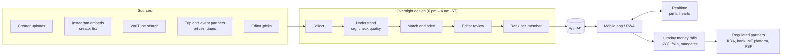
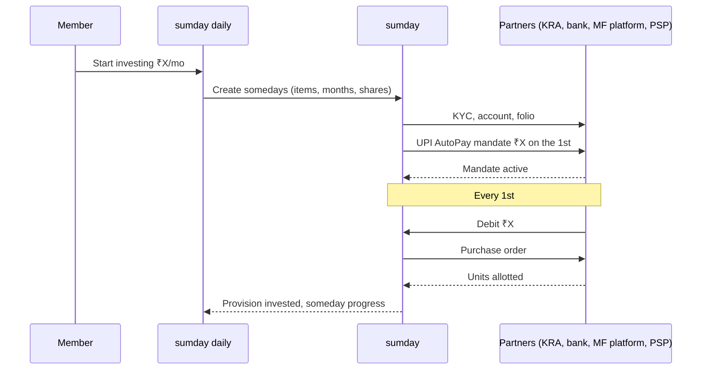

# Architecture

How sumday daily is built. For engineering. Product rules live in the [PRD](../PRD.md); the learning feed is in [AI-MODEL.md](AI-MODEL.md).

The stack below is a recommendation. Swap in whatever sumday's existing app already uses; the shape matters more than the tools.

## 1. The big picture

## 2. Components

| Component | What it does | Suggested tools |
| --- | --- | --- |
| App | Feed, drawer, vision board, sumday dashboard | React Native (Expo) for iOS and Android; a PWA for the beta |
| App API | Feed, wish list, jams, plan, dashboard | TypeScript (Node), REST + JSON, Postgres |
| Realtime | Jam presence, stickers, sketches, notes | WebSockets (a managed service such as Ably or Pusher, or Postgres listen/notify behind a socket server) |
| Edition builder | The overnight pipeline | Job queue (BullMQ on Redis) with one job per stage |
| Content store | Posts, media, credits, licences | Postgres + object storage |
| Media pipeline | Crop to 4:5 and 9:16, transcode video, posters | A managed video service (Mux or Cloudflare Stream) or ffmpeg workers |
| Catalogue and pricing | Experiences, partners, "from" prices, dates | Postgres; nightly partner price sync |
| Ranking service | Order each member's edition | Batch job writing one ordered list per member; see [AI-MODEL](AI-MODEL.md) |
| Model gateway | Tagging, quality checks, editor drafts | Claude API: Haiku 5.5 for bulk tagging, Sonnet 5.5 for matching and checks |
| Notifications | One push a day, jam replies, mandate updates | FCM/APNs through one provider; SMS for money events |
| sumday rails | KYC, bank, folio, mandates, orders, redemptions | sumday's existing backend and partners |
| Analytics | Events, dashboards, experiments | An event pipeline (e.g. PostHog or Segment into a warehouse) |

## 3. The overnight edition

One job per stage. Each stage writes its results to Postgres, so a failed stage can be re-run without starting over.

| Time (IST) | Stage | Does | Output |
| --- | --- | --- | --- |
| 18:00 | Collect | Pulls new posts from the creator list and partners; spends search quota on places members hearted that day | Raw candidates |
| 20:00 | Understand | Tags place, country, category, activity, season, people, on-screen text; scores image or video quality; drops reposts and AI imagery | Tagged candidates + reject reasons |
| 21:00 | Match and price | Links each candidate to an experience in the catalogue; attaches the dated "from" price | Priced candidates |
| 22:00 | Editor review | The editor approves about 150 cards, edits copy, picks hotspots | The edition |
| 00:00 | Rank | Builds each member's order, inserts squad, runway, highlights and wish-list modules | One feed per member |
| 04:00 | Gate | If no approved edition: re-order yesterday's | Fallback edition |
| 06:00 local | Publish | Edition goes live; push scheduled for the member's time | Live feed |

Alerts: the editor and on-call engineer at 03:00 if the edition isn't approved.

## 4. Data model

Main entities. Fields are indicative.

| Entity | Key fields |
| --- | --- |
| `member` | id, name, phone, city, time zone, push time, monthly comfort amount, consent flags |
| `experience` | id, name, place, country, categories[], activities[], best months, expected date, duration, partner id |
| `price_quote` | experience id, partner id, amount, currency, split (flights, stay, experience, food), checked at |
| `media` | id, experience id, kind (photo, video), url, poster, shape (4:5, 9:16), creator id, licence, source url, illustrative flag |
| `creator` | id, name, handles, licence agreement, payout details, opt-out flag |
| `card` | id, edition date, experience id, media ids[], kind (post, carousel, reel, video), copy, hotspots[], tip, approved by |
| `edition` | date, status (building, approved, live, fallback), approved at |
| `feed_slot` | member id, edition date, position, card id or module type |
| `heart` | member id, experience id, created at |
| `jam` | id, experience id, created by |
| `jam_member` | jam id, member id, status (tagged, in, maybe, left) |
| `jam_item` | jam id, kind (sticker, sketch, note), payload, author, created at |
| `someday` | member id, experience id, target amount, share, target month, pinned price id, paused |
| `provision` | someday id, month, amount, status (scheduled, debited, invested, failed) |
| `event` | member id, name, properties, at |

Money records (folio, units, NAV, orders) stay in sumday's existing ledger. A `someday` only references them.

## 5. API

REST, JSON, authenticated per member.

| Method and path | Purpose |
| --- | --- |
| `GET /feed?date=&cursor=` | The member's ordered feed for an edition, paged |
| `GET /stories?date=` | Story circles for the edition |
| `GET /experiences/:id` | Drawer detail: media, tips, price split, friends |
| `GET /experiences?country=&q=&activity=&category=` | Filter results |
| `POST /hearts` · `DELETE /hearts/:experienceId` | Heart and un-heart |
| `GET /wishlist` | Hearted experiences with shares and dates |
| `POST /jams` · `POST /jams/:id/members` · `PATCH /jams/:id/members/me` | Start a jam, tag a friend, reply in or maybe |
| `POST /jams/:id/items` | Sticker, sketch or note |
| `GET /plan` | Vision board: items, share, months, provisions, chart |
| `POST /somedays` | Turn hearted items into somedays (hand-off to sumday) |
| `PATCH /somedays/:id` | Move month, pause, resume |
| `POST /somedays/:id/pin` | Pin the partner's price |
| `POST /events` | Analytics batch |

Realtime channel per jam: `jam:{id}` with `member.updated`, `item.added`, `item.moved`.

## 6. The money rails (sumday)

The feed hands off; sumday does the money. These are the flows the dashboard needs.

1. **KYC.** Aadhaar and PAN through a KYC registration agency (KRA), once per member.
2. **Accounts in the member's name.** A savings account with the partner bank and a mutual-fund folio on the member's PAN.
3. **Mandate.** One UPI AutoPay mandate (e-NACH as a fallback for large amounts) for the sum of provisions, debited on the 1st. Check NPCI's current AutoPay limits for mutual-fund mandates.
4. **Orders.** Each debit becomes a purchase order through a distributor platform (BSE StAR MF or NSE NMF II) into the member's chosen fund from the facts-only shelf.
5. **Goal tagging.** sumday's ledger splits units across somedays by provision. One folio, many goals.
6. **Pin.** A price hold with the trip partner, paid from the member's account. Terms come from the partner (see PRD open questions).
7. **Redemption.** Before the trip date, units are redeemed to the member's own bank account, with tax shown first. Booking happens with the partner.
8. **Exits.** Pause skips the next debit. Withdraw redeems everything, with no penalty from sumday.

## 7. Media

- Store originals privately; serve only processed versions through a CDN.
- Photos: 1080 px wide, 4:5 crop for posts, square thumbs, WebP/AVIF with JPEG fallback.
- Video: 4:5 and 9:16 crops, H.264 MP4 (plays everywhere, including iPhone) plus an adaptive stream for long clips, muted by default, poster frame, 6–20 seconds for feed clips.
- Keep the credit, licence and source URL with every file. The app refuses to show media without them.

## 8. Notifications

- One morning push at the member's chosen time, only with something specific ("Riya tagged you on Monaco").
- Jam replies in real time, batched to at most one push every 30 minutes.
- Money events by push and SMS: mandate set, provision debited, provision failed, pause, withdrawal.

## 9. Security and privacy

- India's Digital Personal Data Protection Act, 2023: clear consent screens, purpose-limited use, export and deletion on request.
- PAN, Aadhaar and bank details stay in sumday's regulated systems, never in the feed's database.
- Encrypt personal data at rest; mask PAN and account numbers in logs; keep an audit log of every money action.
- Friends see only what the member has shared with them.
- Models never see financial data. The ranking uses hearts, views and jams, not balances.

## 10. Environments

- `dev`, `staging` (partner sandboxes, fake money), `prod`.
- Feature flags for each phase and for the learned ranker.
- Dashboards: edition built on time, feed load time, video start time, heart rate, jam rate, mandate funnel, failed debits.

## 11. Running cost

See the [feed plan](https://claude.ai/artifact/P43pNBzeBAsSwDC4ogSrVk), section "Running cost". In short: about $420 a month at 1,000 members and about $3,560 at 100,000 for technology, plus the editor and creator licences. Model costs stay flat because they run once per edition, not once per member.
